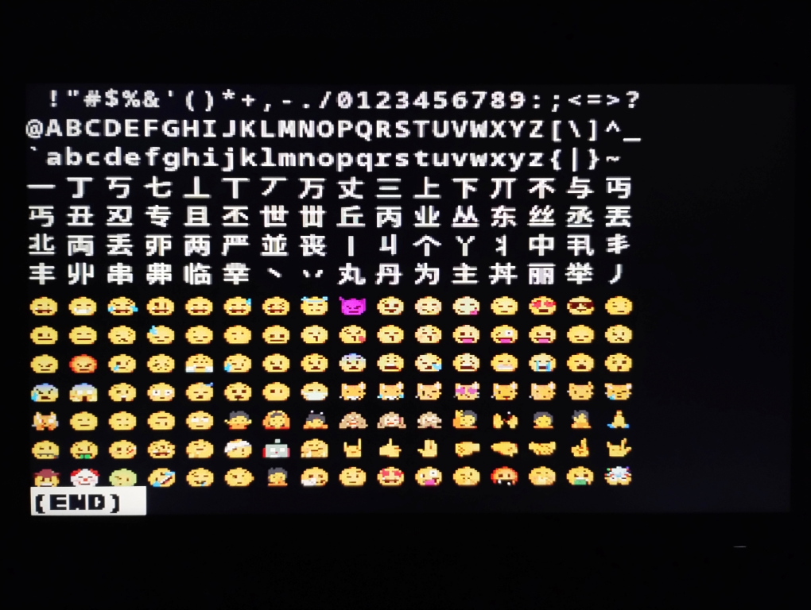

# Raspberry pi Pico用bm_term

<div style="text-align:right">2026年10月13日</div>

## 概要



リモートシェルサーバー[bm_shell](http://akino-yo.f5.si/akinoyonika/bm_shell/)のクライアントbm_termを[Raspberry Pi Pico](https://www.raspberrypi.com/products/raspberry-pi-pico/)で作成しました。
モニターとキーボードを接続したRaspberry Pi Picoでbm_shellが稼働しているlinuxマシンにログインし、リモートシェルを実現します。
以下に、注意点を示します。

- picoで構成されたbm_termは通信インターフェイスをシリアルポートとしています。
  単体ではネットワークに接続できないため、ネットワーク接続用に別途Raspberry Pi Pico Wを準備する必要があります。
- 画面表示のためのDVI (HDMI)接続できるモニターが必要です。
  DVI出力は640X480 60Hz、720x480 60Hz、800x480 60Hz、800x600 60Hz、960x540p 60Hzのいずれかをメイク時に選択できますが、2x2ピクセルを1x1ピクセルとして描画しますので、実質的な解像度は半分になります。
- キー入力のためのUSBキーボードが必要です。
  US配列に対応しています。
- 本製作は組み込み機器上での基本動作を確認するための原理試作としています。
  実用的に使用するために解決すべき問題のいくつかは残されています。

DVI出力は[PicoDVI](https://github.com/Wren6991/PicoDVI)を利用させていただきました。
なお、PicoDVIは3条項BSDライセンスにて公開されています。
以下にPicoDVIのライセンス表示を行います。

<details><summary>Copyright (c) 2021, Luke Wren</summary>

BSD 3-Clause License

Copyright (c) 2021, Luke Wren<br/>
All rights reserved.

Redistribution and use in source and binary forms, with or without
modification, are permitted provided that the following conditions are met:

1. Redistributions of source code must retain the above copyright notice, this
   list of conditions and the following disclaimer.

2. Redistributions in binary form must reproduce the above copyright notice,
   this list of conditions and the following disclaimer in the documentation
   and/or other materials provided with the distribution.

3. Neither the name of the copyright holder nor the names of its
   contributors may be used to endorse or promote products derived from
   this software without specific prior written permission.

THIS SOFTWARE IS PROVIDED BY THE COPYRIGHT HOLDERS AND CONTRIBUTORS "AS IS"
AND ANY EXPRESS OR IMPLIED WARRANTIES, INCLUDING, BUT NOT LIMITED TO, THE
IMPLIED WARRANTIES OF MERCHANTABILITY AND FITNESS FOR A PARTICULAR PURPOSE ARE
DISCLAIMED. IN NO EVENT SHALL THE COPYRIGHT HOLDER OR CONTRIBUTORS BE LIABLE
FOR ANY DIRECT, INDIRECT, INCIDENTAL, SPECIAL, EXEMPLARY, OR CONSEQUENTIAL
DAMAGES (INCLUDING, BUT NOT LIMITED TO, PROCUREMENT OF SUBSTITUTE GOODS OR
SERVICES; LOSS OF USE, DATA, OR PROFITS; OR BUSINESS INTERRUPTION) HOWEVER
CAUSED AND ON ANY THEORY OF LIABILITY, WHETHER IN CONTRACT, STRICT LIABILITY,
OR TORT (INCLUDING NEGLIGENCE OR OTHERWISE) ARISING IN ANY WAY OUT OF THE USE
OF THIS SOFTWARE, EVEN IF ADVISED OF THE POSSIBILITY OF SUCH DAMAGE.

</details>

## デバイスの接続

### DVIインターフェイス

PicoDVIは本来、PicoのSOCであるRP2040を搭載したボードです。
このボードには(コネクターはHDMIですが)DVIインターフェイスが備えられています。
このプロジェクトでRP2040でのDVI出力を成功させたことから、PicoのアドオンボードとしてのDVIインターフェイスが各種発売されています。
PicoDVIプロジェクト自身もいくつかの[ボードサポート](https://github.com/Wren6991/PicoDVI/tree/master/software#support-for-different-boards)を行っています。

本プロジェクトにおいてはDVIインターフェイスに[ピープルメディア社](https://www.peoplemedia.jp/)製[PICO-HDMI-PLUS](https://www.microfan.jp/2024/07/pico-hdmi-plus/)を使用しました。

もし、ほかのボードを用いる場合、上記ボードサポートの情報をもとに必要に応じて設定を切り替えてください。
(設定はソースツリー中の<tt>PicoDVI/include/common_dvi_pin_configs.h</tt>にあります。)

なお、本システムではPicoDVIのソースコードの必要な部分のみを<tt>PicoDVI</tt>ディレクトリ以下にコピーして用いています。

### Pico W

Pico Wとはシリアルポートで接続します。
以下に接続を示します。

```
   Pico               Pico W
----------+        +----------
          |1      2|
UART0 TX  |--------| UART0 RX
          |2      1|
UART0 RX  |--------| UART0 TX
          |4      5|
UART0 CTS |--------| UART0 RTS
          |5      4|
UART0 RTS |--------| UART0 CTS
          |3      3|
      GND |--------| GND
          |        |
----------+        +----------
```

なお、PicoとPico Wの電源は別系統にしてください。
現状、PicoとPico Wの起動に時間差を手動でつける必要があるためです。

Pico Wには[Raspberry Pi Pico W用espress_stream](http://akino-yo.f5.si/akinoyonika/espress_stream_for_pico_w/)の<tt>es_ccat</tt>を導入してください。
元の<tt>es_ccat</tt>ではUSB接続のシリアルコンソールが入出力になっています。
本プロジェクトでは、これをハードウェアシリアルに切り替えるよう書き換えを行って<tt>es_ccat</tt>の導入を行います。

```
$ tar zxvf espress_stream_for_pico_w.########.tar.gz
$ cd espress_stream_for_pico_w
$ vi CMakeLists.txt
$ vi bmt_main.c
$ vi net_config.h
$ mkdir build
$ cd build
$ PICO_SDK_PATH=../../pico-sdk PICO_BOARD=pico_w cmake ..
$ make es_ccat
```

<tt>CMakeLists.txt</tt>と<tt>bmt_main.c</tt>の編集でハードウェアシリアルへの対応を行います。

<tt>CMakeLists.txt</tt>の編集では、<tt>LIBRARIES</tt>変数へ<tt>hardware_uart</tt>を追加してください。

```
set(LIBRARIES
       pico_stdlib
       pico_cyw43_arch_lwip_threadsafe_background
       espress_stream
)

    │
    ↓

set(LIBRARIES
       pico_stdlib
       pico_cyw43_arch_lwip_threadsafe_background
       hardware_uart
       espress_stream
)
```

<tt>bmt_main.c</tt>の編集では、定義<tt>IS_CON_HWSERIAL</tt>の値を1に、定義<tt>UART_BOUD_RATE</tt>の値を2000000に変更してください。

```
#include "net_config.h"

#define IS_CON_HWSERIAL (0)

#if IS_CON_HWSERIAL
#   include "hardware/uart.h"
#   define UART_ID (uart0)
#   define UART_BOUD_RATE (921600)
#   define GPIO_UART_TX  (0) // PIN 1
#   define GPIO_UART_RX  (1) // PIN 2
#   define GPIO_UART_CTS (2) // PIN 4
#   define GPIO_UART_RTS (3) // PIN 5
#endif

    │
    ↓

#include "net_config.h"

#define IS_CON_HWSERIAL (1)

#if IS_CON_HWSERIAL
#   include "hardware/uart.h"
#   define UART_ID (uart0)
#   define UART_BOUD_RATE (2000000)
#   define GPIO_UART_TX  (0) // PIN 1
#   define GPIO_UART_RX  (1) // PIN 2
#   define GPIO_UART_CTS (2) // PIN 4
#   define GPIO_UART_RTS (3) // PIN 5
#endif
```

<tt>net_config.h</tt>の編集はRaspberry Pi Pico W用espress_streamのドキュメントを参考にしてください。
<tt>net_config.h</tt>にあるアドレス、ポート、公開鍵の情報は接続するサーバー(bm_shell)の情報になります。

### USBキーボード

USBキーボードはPicoにあるUSBインターフェイスに接続します。
PicoにあるUSBコネクタはMicro-Bレセプタクルです。
USBキーボードからType-Aプラグが出ている場合、Micro-BレセプタクルをType-Aレセプタクルに変換する必要があります。
さらに、電源供給をUSBコネクタから行う場合はこの変換の間に電源を供給するようなケーブルが必要になります。

本プロジェクトではMicro-Bレセプタクル↔Type-Aレセプタクル変換アダプター(下図A)と短いUSB延長ケーブルから電源供給用のUSBプラグが出ているケーブル(下図B)を組み合わせて使用しました。
前者に関してはメーカー不明のものを使用していますので、具体的な商品を紹介できません。
後者に関しては[タイムリー社](https://timely.ne.jp/)製[GM-UH009Y](https://timely.ne.jp/groovy/usbcable/gm-uh009y/)を使用しました。

```
  Pico                                                        Keyboard
--------+                                                    +--------
        |                                                    |
[Micro-B<<Micro-B]----[Type-A<<Type-A]--+--[Type-A<<Type-A]--+
        |:                   ::         |         :          |
--------+:                   ::         |         :          +--------
         :                   ::         |         :
         :                   ::         |         : 5V Power
         :                   ::         |         :+--------
         :                   ::         |         :|
         :                   ::         +--[Type-A>>Type-A]
         :                   ::                   :|
         :                   ::                   :+--------
         :<--------A-------->::<--------B-------->:

[...< -+- Receptacle
>...] -+

<...] -+- Plug
[...> -+
```

なお、本システムはUS配列キーボード用になっています。
他の配列用にするためにはソースコードの変更が必要です。
(<tt>src/bmt_key.c</tt>の<tt>tuh_hid_report_received_cb</tt>関数内にキースキャンコードから文字コード、もしくはエスケープシーケンスへの変換テーブルがあります。
3つありますが、順番に、装飾キーなし、SHIFT装飾あり、CTRL装飾ありに対する変換テーブルです。)

## パッケージ

本システムのソフトウェアはソースパッケージにて提供しています。
以下をダウンロードしてください。

- [bm_term_for_pico_dvi.20261013.tar.gz](http://akino-yo.f5.si/akinoyonika/bm_term_for_pico_dvi/bm_term_for_pico_dvi.20261013.tar.gz)

<details><summary>変更履歴</summary>

bm_term_for_pico_dvi.20261013.tar.gz
: <ul>
    <li>表示部、キー入力部をメインから分離し、モジュール化した。</li>
    <li>モニター出力関連を調整。出力可能解像度の種類を増やした。</li>
  </ul>

bm_term_for_pico_dvi.20260930.tar.gz
: <ul>
    <li>UARTのボーレートを調整。</li>
    <li>モニター出力関連のファンクションはRAM上で動作するように設定。</li>
    <li>ドキュメント加筆修正。</li>
  </ul>

bm_term_for_pico_dvi.20260925.tar.gz
: <ul>
    <li>初版</li>
  </ul>

</details>

## 導入

### 準備

本ソフトウェアはRaspberry Pi Pico C/C++ SDKを用いてソースコードから作成します。
SDKの導入、ソフトウェア作成方法、SDKを用いて作成したソフトウェアのPicoへの導入等の方法は[SDKのドキュメント](https://datasheets.raspberrypi.com/picow/connecting-to-the-internet-with-pico-w.pdf)を参照してください。

SDKを導入されているディレクトリ<tt>pico-sdk</tt>が存在するディレクトリでパッケージの解凍を行っておきます。

```
$ tar zxvf bm_term_for_pico_dvi.########.tar.gz
```

以下ではSDKの導入が完了していることを前提に、サンプルアプリケーションを動作させるためのバイナリーを作成するまでの手順を示します。

### バイナリーの作成

```
$ cd bm_term_for_pico_dvi
$ vi bmt_config.h
$ mkdir build
$ cd build
$ PICO_SDK_PATH=../../pico-sdk PICO_BOARD=pico cmake ..
$ make
```

<tt>bmt_config.h</tt>ではターミナルに関するいくつかの設定を行っています。

```
#define MODE_960x540p_60Hz
#define FONT "noto sans mono, noto color emoji"
#define MODE "130"
#define USER "foo"
#define PASS "tpfBTht8"
```

<tt>MODE</tt>は上記のままで定義してください。

<tt>MODE_960x540p_60Hz</tt>は定義名にあるDVI出力の解像度等を選択するものです。
以下のいずれかを選択できます。

| define                      | rows | columns | line height | char. width |
| --------------------------- | ---: | ------: | ----------: | ----------: |
| <tt>MODE_640x480_60Hz</tt>  |   15 | 40      | 16px        | 8px         |
| <tt>MODE_720x480_60Hz</tt>  |   15 | 45      | 16px        | 8px         |
| <tt>MODE_800x480_60Hz</tt>  |   15 | 50      | 16px        | 8px         |
| <tt>MODE_800x600_60Hz</tt>  |   20 | 50      | 15px        | 8px         |
| <tt>MODE_960x540p_60Hz</tt> |   18 | 60      | 15px        | 8px         |

モニターの2x2ピクセルを1x1ピクセルとして描画しますので、実質的な解像度は半分になります。
上記表中の1pxはモニターでは2pxに相当しますので、ご注意ください。

<tt>FONT</tt>はサーバー側のフォントの指定を行います。
Fontconfigに渡され、フォントが検索されます。
例にある<tt>"noto sans mono, noto color emoji"</tt>はubuntuの日本語環境では適切な指定かと思います。

<tt>USER</tt>にはログインユーザー名を<tt>PASS</tt>にはログインパスワードを指定してください。

以上の手順で<tt>build</tt>ディレクトリに<tt>bm_term.uf2</tt>が作成されます。
これをPicoに導入してください。

## 使用方法

ログインしたいlinuxマシン上でbm_shellを稼働させておいてください。

HDMIケーブルをモニターに接続せず、Picoの電源を投入します。
(本ハードウェア構成では電源ONのモニターをHDMI端子に接続すると電圧がPicoに回り込んでしまうようで、そのあと電源を投入してもうまくリセットがかかりませんでした。)
そのあとHDMIケーブルをモニターに接続し、カラーパターンが表示されるのを確認します。
カラーパターンが表示された後、Pico Wの電源を投入します。
しばらくしてコマンドプロンプトが表示されるでしょう。
キーボードを使ってコマンド等が入力できることを確認してください。

ログインしたシェルから<tt>exit</tt>を実行すると"logout" (日本語環境の場合は"ログアウト")が表示され、動作が停止します。
HDMIケーブルをモニターから抜き取り、PicoとPico Wの電源を切断してください。

## ライセンス

MITライセンスに基づいてリリースされています。

<details><summary>Copyright 2026 akinoyonika</summary>

Permission is hereby granted, free of charge, to any person obtaining a copy of this software and associated documentation files (the “Software”), to deal in the Software without restriction, including without limitation the rights to use, copy, modify, merge, publish, distribute, sublicense, and/or sell copies of the Software, and to permit persons to whom the Software is furnished to do so, subject to the following conditions:

The above copyright notice and this permission notice shall be included in all copies or substantial portions of the Software.

THE SOFTWARE IS PROVIDED “AS IS”, WITHOUT WARRANTY OF ANY KIND, EXPRESS OR IMPLIED, INCLUDING BUT NOT LIMITED TO THE WARRANTIES OF MERCHANTABILITY, FITNESS FOR A PARTICULAR PURPOSE AND NONINFRINGEMENT. IN NO EVENT SHALL THE AUTHORS OR COPYRIGHT HOLDERS BE LIABLE FOR ANY CLAIM, DAMAGES OR OTHER LIABILITY, WHETHER IN AN ACTION OF CONTRACT, TORT OR OTHERWISE, ARISING FROM, OUT OF OR IN CONNECTION WITH THE SOFTWARE OR THE USE OR OTHER DEALINGS IN THE SOFTWARE.

</details>